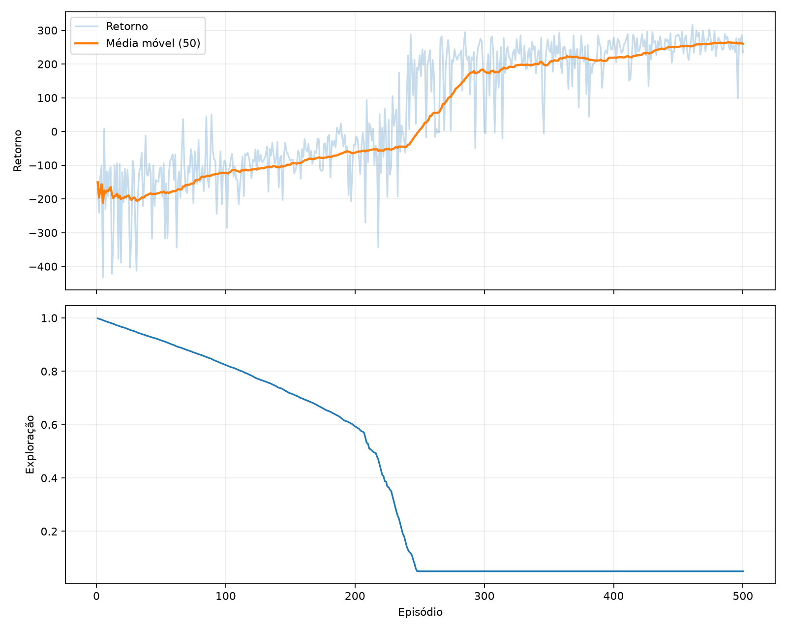

# Agente Double DQN para controle autônomo no ambiente LunarLander-v3

**Disciplina:** Inteligência Artificial II  
**Atividade:** Contexto de Aprendizagem — Parada Obrigatória 2   
**Integrantes:** Hugo Porto Santos Ferraro; Aleixo de Santana Martins; Flávio Fox Sandes Araújo Fernandes; Lucas Wanderley de Oliveira
**Instituição:** SENAI CIMATEC

---

## Resumo

Este trabalho apresenta o desenvolvimento de um agente de aprendizado por reforço profundo para
controle autônomo no ambiente complexo `LunarLander-v3`. O ambiente foi fornecido pelo Gymnasium,
sucessor mantido do OpenAI Gym, e o modelo foi implementado em Python com TensorFlow/Keras. A
solução emprega Double Deep Q-Network (Double DQN), duas redes neurais densas — on-line e alvo —,
replay de experiências e exploração *epsilon-greedy*. Uma busca aleatória reduzida comparou três
configurações durante 120 episódios cada; a configuração selecionada foi então treinada por 500
episódios, totalizando 168.453 transições. A avaliação final utilizou 100 episódios com sementes
não empregadas no treinamento nem no ajuste de hiperparâmetros. O agente alcançou retorno médio
de 221,47 pontos (IC 95%: 208,31–234,63), mediana de 241,40 e taxa operacional de sucesso de 68%,
definida como retorno igual ou superior a 200. Nas mesmas sementes, uma política aleatória obteve
média de −192,75 e taxa de sucesso de 0%. Os resultados mostram que o agente aprendeu uma política
substancialmente superior ao acaso e atingiu o critério principal estabelecido. A análise também
identifica limitações relacionadas ao número reduzido de tentativas de tuning, à avaliação de uma
única seed de treinamento final e à variabilidade residual entre episódios.

**Palavras-chave:** aprendizado por reforço; deep learning; Double DQN; Gymnasium; TensorFlow;
LunarLander.

---

## Sumário

1. [Introdução](#1-introdução)
2. [Fundamentação teórica](#2-fundamentação-teórica)
3. [Ambiente e formulação do problema](#3-ambiente-e-formulação-do-problema)
4. [Metodologia](#4-metodologia)
5. [Dataset de experiência e treinamento](#5-dataset-de-experiência-e-treinamento)
6. [Otimização de hiperparâmetros](#6-otimização-de-hiperparâmetros)
7. [Resultados](#7-resultados)
8. [Análise crítica](#8-análise-crítica)
9. [Recomendações e trabalhos futuros](#9-recomendações-e-trabalhos-futuros)
10. [Conclusão](#10-conclusão)
11. [Reprodutibilidade](#11-reprodutibilidade)
12. [Referências](#12-referências)
13. [Apêndices](#13-apêndices)

---

## 1. Introdução

O aprendizado por reforço (*Reinforcement Learning*, RL) estuda agentes que aprendem a tomar
decisões por meio da interação com um ambiente. Em vez de receber pares rotulados de entrada e
saída, o agente observa um estado, escolhe uma ação e recebe uma recompensa juntamente com um
novo estado. Seu objetivo é aprender uma política que maximize a recompensa acumulada ao longo
do tempo.

O domínio selecionado foi o controle de trajetória e pouso do `LunarLander-v3`. Trata-se de um
problema de controle dinâmico no qual uma ação pode produzir consequências muitos passos depois,
exigindo equilíbrio entre exploração, estabilidade, consumo de combustível e segurança. O
ambiente é classificado como complexo no enunciado da atividade e oferece uma dificuldade maior
que problemas introdutórios como `CartPole-v1`.

O objetivo geral foi desenvolver, otimizar e avaliar um agente baseado em deep learning capaz de
operar o módulo lunar de forma autônoma. Foram definidos os seguintes objetivos específicos:

1. integrar o ambiente Gymnasium à aplicação em TensorFlow/Keras;
2. implementar um agente Double DQN com replay de experiências e rede-alvo;
3. comparar configurações por meio de busca aleatória de hiperparâmetros;
4. registrar configurações, seeds, checkpoints e métricas de forma reproduzível;
5. comparar o modelo final com uma política aleatória nas mesmas condições; e
6. obter retorno médio de pelo menos 200 pontos em 100 episódios de teste inéditos.

O critério de 200 pontos foi adotado como limiar operacional de sucesso e também empregado para
calcular a proporção de episódios bem-sucedidos. Essa métrica não significa que todo episódio
acima do limiar seja fisicamente idêntico; ela resume a qualidade global da trajetória conforme a
função de recompensa do ambiente.

## 2. Fundamentação teórica

### 2.1 Processo de decisão e retorno

O problema pode ser representado como um processo de decisão de Markov. No instante \(t\), o
agente observa \(s_t\), executa \(a_t\), recebe \(r_{t+1}\) e passa ao estado \(s_{t+1}\). O retorno
descontado é definido por:

\[
G_t = \sum_{k=0}^{\infty} \gamma^k r_{t+k+1},
\]

em que \(\gamma\) é o fator de desconto. Neste projeto, \(\gamma=0{,}99\), atribuindo peso elevado
a recompensas futuras sem eliminar a preferência por resultados mais imediatos.

### 2.2 Deep Q-Network

O Q-learning busca aproximar \(Q(s,a)\), o retorno esperado ao selecionar uma ação em um estado e
seguir a política aprendida. O Deep Q-Network (DQN) substitui uma tabela por uma rede neural, o
que permite generalizar entre estados contínuos. O trabalho de Mnih et al. demonstrou a
combinação de rede neural, replay de experiências e rede-alvo para estabilizar o aprendizado
profundo por reforço [1].

No DQN convencional, a mesma estimativa é usada para selecionar e avaliar a melhor ação futura.
Erros e ruído podem, portanto, causar superestimação sistemática. O Double DQN separa essas
responsabilidades: a rede on-line escolhe a ação, enquanto a rede-alvo estima seu valor. Essa
modificação foi proposta por van Hasselt, Guez e Silver para reduzir a superestimação e melhorar
a estabilidade [2].

O alvo empregado neste projeto é:

\[
y_t = r_{t+1} + \gamma(1-d_t)
Q_{\text{alvo}}\left(s_{t+1},
\operatorname*{arg\,max}_a Q_{\text{on-line}}(s_{t+1},a)\right),
\]

em que \(d_t=1\) apenas quando há término natural (`terminated`). Uma interrupção por limite de
tempo (`truncated`) encerra o episódio, mas não anula automaticamente o valor estimado do próximo
estado. Essa separação segue a API atual do Gymnasium [3].

### 2.3 Exploração e replay de experiências

A política de coleta é *epsilon-greedy*: com probabilidade \(\epsilon\), seleciona-se uma ação
aleatória; caso contrário, seleciona-se a ação de maior valor Q. O epsilon decai linearmente de
1,00 para 0,05 durante 50.000 passos.

Cada transição é armazenada em um replay buffer circular. Lotes aleatórios quebram parte da
correlação temporal das observações consecutivas e permitem reutilizar experiências. O buffer
utilizado possui capacidade de 100.000 transições e o treinamento começa após um aquecimento de
5.000 passos.

## 3. Ambiente e formulação do problema

### 3.1 Escolha e versão

O enunciado menciona `LunarLander-v2`, versão disponível à época de materiais anteriores. O
projeto utilizou `LunarLander-v3`, identificador atual documentado pelo Gymnasium. A versão v3 foi
introduzida após correções no ambiente, preservando a tarefa de pouso [4]. Gymnasium é o fork
mantido do OpenAI Gym; portanto, atende à intenção tecnológica da atividade usando a implementação
atual e suportada.

O ambiente foi escolhido por três razões:

- é listado como opção complexa para grupos pares;
- possui dinâmica física e recompensa mais informativa que ambientes introdutórios; e
- apresenta ações discretas e observações vetoriais, permitindo estudar Double DQN sem o custo
  adicional de processamento de imagens de ambientes Atari.

### 3.2 Observações

Cada observação é um vetor `float32` de oito elementos:

| Índice | Informação aproximada |
|---:|---|
| 0 | posição horizontal |
| 1 | posição vertical |
| 2 | velocidade horizontal |
| 3 | velocidade vertical |
| 4 | ângulo do módulo |
| 5 | velocidade angular |
| 6 | contato da perna esquerda |
| 7 | contato da perna direita |

### 3.3 Ações

Foi usada a variante discreta `Discrete(4)` [4]:

| Ação | Comando |
|---:|---|
| 0 | não acionar motor |
| 1 | acionar motor lateral esquerdo |
| 2 | acionar motor principal |
| 3 | acionar motor lateral direito |

### 3.4 Recompensas e finalização

A recompensa considera progresso em direção à plataforma, velocidade, inclinação, contato das
pernas, consumo dos motores, pouso e colisão. A documentação oficial informa que a escala foi
normalizada em torno de 200 pontos e descreve bônus e penalidades de contato [4].

Um episódio termina quando o módulo colide, pousa e deixa de se mover, ou sai dos limites
relevantes do ambiente. O wrapper limita cada episódio a 1.000 passos. No código, tanto
`terminated` quanto `truncated` encerram o laço; somente `terminated` remove o bootstrap do alvo.

## 4. Metodologia

### 4.1 Arquitetura de software

O repositório segue o layout `src` e separa as responsabilidades:

```text
Configuração YAML
       │
       ▼
Interface CLI ──► Ambiente Gymnasium
       │                 │
       ▼                 ▼
Trainer ──► DoubleDQNAgent ──► ReplayBuffer
       │          │
       │          ├──► rede on-line
       │          └──► rede-alvo
       ▼
CSV + TensorBoard + checkpoint + gráfico + JSON
```

O arquivo `main.py` expõe os comandos `tune`, `train`, `evaluate` e `demo`. Configuração,
ambiente, agente, rede, replay buffer, treinamento, avaliação, tuning e relatórios são mantidos em
módulos independentes. Essa divisão reduz acoplamento e permite testar isoladamente a lógica de
configuração, memória e atualização Double DQN.

### 4.2 Rede neural

A configuração vencedora usa uma rede totalmente conectada:

```text
Entrada (8)
   ↓
Dense (256, ReLU)
   ↓
Dense (256, ReLU)
   ↓
Saída linear (4 valores Q)
```

O modelo possui 69.124 parâmetros treináveis:

- primeira camada: \(8\times256+256=2.304\);
- segunda camada: \(256\times256+256=65.792\);
- saída: \(256\times4+4=1.028\).

Uma segunda rede de mesma arquitetura funciona como rede-alvo e não recebe gradientes. Seus
pesos são substituídos pelos pesos on-line a cada 1.000 atualizações.

### 4.3 Otimização

Foi utilizado Adam com taxa de aprendizado de aproximadamente \(4{,}3643\times10^{-4}\), perda
Huber e norma máxima de gradiente igual a 10. A perda Huber combina comportamento quadrático para
erros pequenos e linear para erros grandes, reduzindo a influência de alvos extremos.

### 4.4 Reprodutibilidade

Foram fixadas seeds para Python, NumPy, TensorFlow, ambiente, espaço de observações e espaço de
ações. `tf.keras.utils.set_random_seed` centraliza as seeds de Python, NumPy e TensorFlow [5]. O
treinamento final utilizou seed 42. A execução ocorreu em:

| Componente | Valor |
|---|---|
| Python | 3.12.16 |
| TensorFlow | 2.21.0 |
| Gymnasium | 1.4.0 |
| Sistema | WSL2, Linux 6.18.33.2 |
| GPU | NVIDIA GeForce RTX 5060 Ti, 16 GB |

A GPU possui compute capability 12.0a; o TensorFlow compilou kernels PTX na primeira execução. A
configuração do ambiente e os caminhos CUDA necessários estão documentados no `README.md`.

## 5. Dataset de experiência e treinamento

### 5.1 Natureza do dataset

Não foi utilizado um dataset supervisionado externo. Em aprendizado por reforço on-line, o
dataset é produzido pelo próprio agente durante a interação. Cada amostra possui:

\[
(s_t, a_t, r_{t+1}, s_{t+1}, d_t).
\]

Os estados e próximos estados possuem oito valores; a ação é um inteiro; a recompensa é escalar;
e \(d_t\) registra término natural. A truncagem encerra a coleta do episódio, mas é mantida fora
do indicador terminal armazenado, permitindo bootstrap correto.

### 5.2 Armazenamento e amostragem

O replay buffer é pré-alocado com tipos NumPy (`float32` para estados, recompensas e terminação;
`int64` para ações). A capacidade de 100.000 significa que, após seu preenchimento, experiências
antigas são sobrescritas circularmente. O treino final gerou 168.453 transições; assim, o buffer
final continha as 100.000 experiências mais recentes, embora todas as 168.453 tenham influenciado
o processo ao longo do treinamento.

Cada atualização utiliza 64 transições distintas, amostradas uniformemente sem reposição dentro
do lote. O aquecimento de 5.000 passos evita otimizar sobre um conjunto inicial excessivamente
pequeno.

### 5.3 Protocolo de treinamento

O treinamento final teve 500 episódios e seed base 42. O reset de cada episódio recebeu a seed
`42 + número do episódio`. A cada passo:

1. calcula-se o epsilon correspondente ao número total de interações;
2. escolhe-se uma ação epsilon-greedy;
3. executa-se a ação e armazena-se a transição;
4. sorteia-se um lote, quando o aquecimento já foi atingido;
5. calcula-se o alvo Double DQN e uma atualização por Adam; e
6. atualiza-se periodicamente a rede-alvo.

A cada 25 episódios, a política gulosa foi avaliada em cinco seeds fixas. O checkpoint com maior
média nessas seeds foi salvo. O melhor checkpoint ocorreu no episódio 475, com média de validação
262,09. O treinamento prosseguiu até 500 episódios, alcançando 168.453 passos. Na avaliação
secundária de cinco seeds realizada ao final, o checkpoint selecionado obteve média 234,52 e 80%
dos episódios acima de 200.



**Figura 1 —** Curvas registradas durante o treinamento final. Fonte: elaboração própria.

## 6. Otimização de hiperparâmetros

### 6.1 Estratégia

Foi implementada busca aleatória reproduzível. O plano completo previa 12 tentativas, porém a
janela computacional disponível antes da apresentação exigiu uma busca reduzida de três trials,
com 120 episódios cada. Essa limitação é reportada explicitamente e considerada na análise.

O espaço amostrado foi:

| Hiperparâmetro | Valores ou intervalo |
|---|---|
| taxa de aprendizado | log-uniforme entre \(10^{-4}\) e \(10^{-3}\) |
| camadas ocultas | `[128,128]`, `[256,128]` ou `[256,256]` |
| batch | 64 ou 128 |
| gamma | 0,99 ou 0,995 |
| atualização da rede-alvo | 500, 1.000 ou 2.000 passos |
| decaimento do epsilon | 50.000, 100.000 ou 150.000 passos |

As três configurações foram treinadas com seeds 2026, 2027 e 2028. Para classificação, cada
checkpoint foi avaliado nas seeds 1001, 1002 e 1003.

### 6.2 Resultados do tuning

| Trial | Rede | Taxa de aprendizado | Batch | Gamma | Rede-alvo | Decaimento ε | Média de classificação |
|---:|---|---:|---:|---:|---:|---:|---:|
| 0 | 256×256 | 0,00043643 | 64 | 0,99 | 1.000 | 50.000 | **−103,35** |
| 1 | 256×128 | 0,00022642 | 128 | 0,995 | 2.000 | 150.000 | −107,88 |
| 2 | 256×256 | 0,00044956 | 64 | 0,99 | 500 | 50.000 | −215,02 |

O trial 0 foi escolhido por apresentar a maior média, ainda que negativa. A diferença para o
trial 1 foi pequena (4,53 pontos), enquanto o trial 2 foi claramente inferior. Os resultados
negativos indicam que 120 episódios foram insuficientes para convergência; por isso, o tuning deve
ser interpretado como triagem inicial, não como comparação definitiva. A configuração vencedora
foi retreinada do início por 500 episódios com seed 42.

## 7. Resultados

### 7.1 Protocolo de teste

O modelo testado foi o checkpoint de melhor validação, salvo no episódio 475. A avaliação final
usou política gulosa (epsilon zero), 100 episódios e seeds 300000 a 300099, distintas das seeds de
treinamento, tuning e validação. O baseline aleatório foi executado nas mesmas 100 seeds, isolando
o efeito da política aprendida.

### 7.2 Métricas finais

| Métrica | Double DQN | Política aleatória |
|---|---:|---:|
| episódios | 100 | 100 |
| média | **221,47** | −192,75 |
| mediana | **241,40** | −159,84 |
| desvio-padrão | 67,15 | 115,67 |
| mínimo | 24,99 | −486,42 |
| máximo | 307,68 | 15,65 |
| IC 95% da média | [208,31; 234,63] | [−215,42; −170,08] |
| proporção com retorno ≥ 200 | **68%** | 0% |

A diferença entre as médias foi de 414,22 pontos. O limite inferior do intervalo de confiança do
agente (208,31) permaneceu acima do critério de 200, enquanto o limite superior do baseline foi
negativo. Isso fornece evidência consistente de que o resultado não se deve apenas à variação dos
estados iniciais.

Embora 68 episódios tenham superado 200, ainda houve casos fracos: o mínimo foi 24,99 e 32% não
atingiram o limiar. A mediana maior que a média indica que retornos baixos puxaram a média para
baixo. Assim, o agente é eficaz na maioria dos episódios, mas não totalmente robusto.

### 7.3 Demonstração visual

Foram gravados três episódios adicionais, com seeds separadas da avaliação principal:

| Arquivo | Seed | Retorno |
|---|---:|---:|
| `lunar-lander-episode-0.mp4` | 400000 | 283,31 |
| `lunar-lander-episode-1.mp4` | 400001 | 251,86 |
| `lunar-lander-episode-2.mp4` | 400002 | 274,37 |

Os três episódios superaram 200. O episódio 2 foi selecionado para a apresentação por ser forte e
representativo, sem corresponder ao maior retorno do conjunto.

## 8. Análise crítica

Os resultados atendem ao objetivo principal: média de teste superior a 200 e vantagem expressiva
sobre o baseline. A evolução também é coerente com o aprendizado. Até aproximadamente o episódio
225, as validações permaneciam negativas; a partir do episódio 250 surgiram retornos de treino
acima de 200. O melhor checkpoint foi observado próximo ao final, no episódio 475, indicando que o
orçamento de 500 episódios foi relevante.

Entretanto, quatro limitações impedem conclusões mais amplas:

1. **Tuning reduzido.** Somente três configurações foram avaliadas por 120 episódios. A pequena
   diferença entre os dois melhores trials e seu desempenho ainda negativo tornam a seleção
   sensível ao orçamento e às seeds.
2. **Uma seed de treinamento final.** A avaliação usa 100 seeds de ambiente, mas existe apenas um
   modelo treinado com seed base 42. Não foi medida a variância entre treinamentos independentes.
3. **Reutilização das seeds de validação.** Os mesmos cinco episódios guiaram a seleção periódica
   do checkpoint. Isso pode favorecer indiretamente essas condições. O teste final separado reduz,
   mas não elimina, o risco metodológico.
4. **Variabilidade residual.** O desvio-padrão de 67,15 e o mínimo de 24,99 mostram que a política
   ainda falha em condições específicas, apesar da boa média.

O uso de GPU não elimina o custo do ambiente, que executa física e lógica no CPU. Além disso, a
rede relativamente pequena gera operações em que transferências e chamadas Python podem limitar
o ganho da GPU. A RTX 5060 Ti exigiu compilação PTX por não haver kernel nativo para compute
capability 12.0a no wheel utilizado.

Do ponto de vista de engenharia, o projeto registra os dados necessários para auditoria:
configuração YAML, runtime, CSV por episódio, TensorBoard, checkpoint, resumo JSON, resultados de
tuning, avaliação e vídeos. Os testes automatizados cobrem configuração, replay buffer, cálculo
Double DQN, persistência do modelo, CLI e integração com Box2D.

## 9. Recomendações e trabalhos futuros

Recomenda-se:

1. executar a busca original de 12 ou mais trials com orçamento suficiente para que cada política
   ultrapasse a fase inicial de exploração;
2. retreinar a configuração vencedora em pelo menos cinco seeds e reportar média e intervalo
   entre treinamentos;
3. separar conjuntos fixos de validação e teste desde o início e ampliar a validação periódica;
4. adotar replay priorizado, dando maior probabilidade a transições com maior erro temporal;
5. avaliar retornos de múltiplos passos (*n-step returns*), que propagam recompensas mais
   rapidamente;
6. testar arquitetura dueling, separando valor do estado e vantagem de cada ação;
7. comparar Double DQN com PPO ou outro método ator-crítico no mesmo orçamento de interações; e
8. otimizar o laço com funções compiladas e ambientes vetorizados, após validar equivalência.

Uma análise adicional pode classificar falhas por velocidade, ângulo, distância da plataforma e
contato das pernas. Isso permitiria descobrir se os 32 episódios abaixo de 200 compartilham
padrões e orientar coleta direcionada ou modelagem de recompensa.

## 10. Conclusão

Foi desenvolvido um protótipo completo e reproduzível para controle autônomo do
`LunarLander-v3`. O uso de Double DQN foi adequado ao espaço discreto de quatro ações, enquanto a
rede densa explorou diretamente as oito variáveis do estado. O replay buffer, a rede-alvo, a
exploração epsilon-greedy, a perda Huber e o clipping de gradiente contribuíram para estabilizar o
treinamento.

Após busca reduzida de hiperparâmetros e 500 episódios de treinamento final, o modelo obteve
retorno médio de 221,47 em 100 episódios inéditos, com intervalo de confiança de 95% entre 208,31
e 234,63. A política aleatória obteve −192,75 nas mesmas seeds. Portanto, o agente superou o
baseline por 414,22 pontos e atingiu o objetivo quantitativo estabelecido.

Apesar do sucesso, a taxa de 68% acima do limiar e a presença de retornos baixos mostram que o
problema não está completamente resolvido. Os resultados sustentam a eficácia do modelo para o
escopo da atividade, mas também justificam experimentos com mais seeds, tuning mais amplo e
técnicas adicionais de estabilidade.

## 11. Reprodutibilidade

### 11.1 Instalação

O procedimento completo para WSL2, GPU, CUDA e TensorFlow está no `README.md`. Após a instalação
e a verificação de `/device:GPU:0`, o fluxo é:

```bash
# Busca rápida efetivamente utilizada
uv run gymnasium-rl-agent tune --config configs/quick_tuning.yaml

# Treino com o best_config.yaml produzido pelo comando anterior
uv run gymnasium-rl-agent train \
  --config=artifacts/runs/<PASTA-DO-TUNING>/best_config.yaml

# Avaliação final
uv run gymnasium-rl-agent evaluate \
  --config=artifacts/final/config.yaml \
  --model=artifacts/final/model.keras \
  --episodes=100 \
  --include-random-baseline \
  --output=artifacts/final/evaluation.json

# Vídeos
uv run gymnasium-rl-agent demo \
  --config=artifacts/final/config.yaml \
  --model=artifacts/final/model.keras \
  --episodes=3 \
  --record \
  --video-dir=artifacts/final/videos
```

### 11.2 Artefatos entregues

| Artefato | Finalidade |
|---|---|
| `artifacts/final/model.keras` | checkpoint selecionado |
| `artifacts/final/config.yaml` | configuração completa |
| `artifacts/final/training.png` | curva de aprendizado |
| `artifacts/final/training_summary.json` | resumo do treino |
| `artifacts/final/tuning_results.csv` | comparação de hiperparâmetros |
| `artifacts/final/evaluation.json` | teste final e baseline |
| `artifacts/final/videos/*.mp4` | demonstrações visuais |

## 12. Referências

[1] MNIH, Volodymyr et al. Human-level control through deep reinforcement learning. *Nature*,
v. 518, p. 529–533, 2015. DOI: [10.1038/nature14236](https://doi.org/10.1038/nature14236).

[2] VAN HASSELT, Hado; GUEZ, Arthur; SILVER, David. Deep Reinforcement Learning with Double
Q-Learning. *Proceedings of the Thirtieth AAAI Conference on Artificial Intelligence*,
p. 2094–2100, 2016. DOI:
[10.1609/aaai.v30i1.10295](https://doi.org/10.1609/aaai.v30i1.10295).

[3] FARAMA FOUNDATION. Gymnasium Env API. Disponível em:
<https://gymnasium.farama.org/api/env/>. Acesso em: 7 nov. 2026.

[4] FARAMA FOUNDATION. Lunar Lander — Gymnasium Documentation. Disponível em:
<https://gymnasium.farama.org/environments/box2d/lunar_lander/>. Acesso em: 7 nov. 2026.

[5] TENSORFLOW. `tf.config.experimental.enable_op_determinism`. Disponível em:
<https://www.tensorflow.org/api_docs/python/tf/config/experimental/enable_op_determinism>.
Acesso em: 7 nov. 2026.

[6] SUTTON, Richard S.; BARTO, Andrew G. *Reinforcement Learning: An Introduction*. 2. ed.
Cambridge: MIT Press, 2018. Disponível em: <http://incompleteideas.net/book/the-book-2nd.html>.

[7] FARAMA FOUNDATION. Gymnasium: a maintained fork of OpenAI Gym. Disponível em:
<https://gymnasium.farama.org/>. Acesso em: 7 nov. 2026.

## 13. Apêndices

### Apêndice A — Configuração vencedora

```yaml
environment: LunarLander-v3
hidden_layers: [256, 256]
gamma: 0.99
learning_rate: 0.00043642856253592565
batch_size: 64
replay_capacity: 100000
warmup_steps: 5000
epsilon_start: 1.0
epsilon_end: 0.05
epsilon_decay_steps: 50000
target_update_steps: 1000
gradient_clip_norm: 10.0
episodes: 500
max_episode_steps: 1000
seed: 42
```

### Apêndice B — Seeds experimentais

| Etapa | Seeds |
|---|---|
| sorteio da busca | 2026 |
| treinamento dos trials | 2026, 2027 e 2028 |
| classificação dos trials | 1001, 1002 e 1003 |
| treinamento final | 42; resets 43 a 542 |
| validação periódica | 100042 a 100046 |
| avaliação secundária | 200042 a 200046 |
| teste final | 300000 a 300099 |
| vídeos | 400000 a 400002 |

### Apêndice C — Qualidade do código

O projeto utiliza Ruff para análise estática e estilo, mypy para verificação de tipos e pytest
para testes. A suíte contém 12 testes, incluindo teste real de inicialização do Box2D, cálculo do
alvo sem bootstrap em transições terminais, execução de uma atualização do otimizador e
persistência do modelo Keras.

